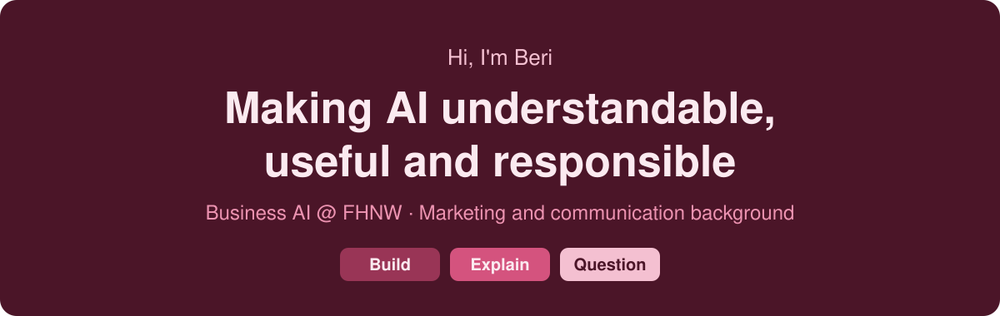

  

  
  
  

I spent years explaining products to customers. Now I build AI and still care most about whether people understand it and can trust it.

---

## Currently building

### [Emergency room triage agent](https://github.com/BerryBrand312/er-triage-dqn)
`er-triage-dqn` · Team project · FHNW

**In one sentence:** teaching an AI to decide who gets treated next in a simulated ER – without ever skipping the most urgent patient.

> **Under the hood:** custom env with `reset()` / `step()` · priority + FIFO baseline · hard safety constraints · seeded synthetic data · 11 pytest tests · next: Gymnasium + DQN

 

### [Bone age from hand X-rays](https://github.com/BerryBrand312/bone-age-prediction)
`bone-age-prediction` · Team project · FHNW

**In one sentence:** estimating a child's bone age from a hand X-ray – and showing which parts of the image the model looks at.

> **Under the hood:** pretrained ResNet → regression head · train/val/test split · augmentation (flip, rotate, contrast) · dropout experiments · Grad-CAM

---

## Technical toolbox

| Area | What I work with |
| --- | --- |
| **Machine learning** | Classification, regression, clustering, evaluation |
| **Deep learning** | CNNs, transfer learning, PyTorch |
| **Reinforcement learning** | Monte Carlo, Q-learning, DQN, simulation |
| **Knowledge-based AI** | Knowledge graphs, ontologies, rule systems |
| **Data** | SQL, ER modelling, data preparation |
| **Engineering** | Python OOP, pytest, Git, reproducible experiments |

## Coursework @ FHNW

<b>BSc Business Artificial Intelligence</b> – show modules

 

**Artificial intelligence**
Introduction to AI · Statistics and Mathematics for Machine Learning · Machine Learning · Knowledge Representation and Reasoning · Human–AI Interaction and Automation · Ethics and Technology Assessment

**Applied projects**
Data-driven Business Applications · Application Development with Python · Machine Learning and Knowledge-based Systems · Hybrid Intelligence

**Business and information systems**
Business Information Systems · Practical project with an industrial SME

**In progress**
Deep Learning · Reinforcement Learning · Business Process Management and Automation

## Next up

---

  
  

